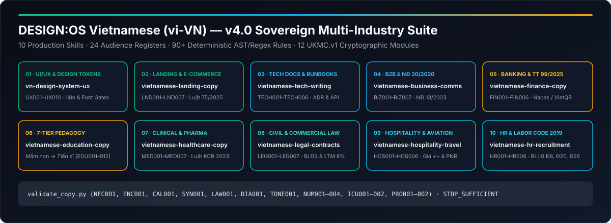

# DESIGN:OS Vietnamese (`design-os-vietnamese`) — v5.1 Multi-Industry Suite

**Sovereign Vietnamese (`vi-VN`) language, typography, UX design system, 7-tier pedagogy (Mầm non -> Tiến sĩ & GS/PGS), and 16-domain statutory compliance suite for AI coding agents.**

Equip Claude Code, OpenAI Codex, Gemini CLI, and Google Antigravity with 16 production skills, 31 audience registers, 100+ deterministic AST/regex rules, 489 golden evaluation pairs, and 18 `UKMC.v1` cryptographically verified knowledge modules.

<p align="center">
  
</p>

<p align="center">
  <a href="LICENSE"></a>
  
  <a href="commands/doctor.md"></a>
  <a href="llms.txt"></a>
  <a href="https://jangtrinh.github.io/design-os-vietnamese/"></a>
  <a href="https://buymeacoffee.com/jangtrinh"></a>
</p>

<p align="center">
  <a href="#quickstart">Quickstart</a> · <a href="#what-it-makes">What it makes</a> · <a href="#installation">Install</a> · <a href="#how-it-works">How it works</a> · <a href="#quality-bar--limitations">Limits</a> · <a href="README.vi.md">Tiếng Việt</a>
</p>

---

## Why this exists

Generic LLMs treat Vietnamese (`vi-VN`) as word-by-word translated English. In production software and regulated industries, that produces four systemic failure modes:

1. **Translationese & Syntactic Calques**: Literal English-to-Vietnamese phrasing (*"Làm ơn nhập của bạn mật khẩu"*, *"Như một người dùng, tôi muốn..."*, *"Thực hiện một quyết định"*) that breaks native trust.
2. **Stacked Diacritic Clipping & UI Expansion**: Vietnamese combines base vowels with circumflex/breve/horn modifiers (`ă, â, ê, ô, ơ, ư`) and five tone marks (`Ấ, Ệ, Ữ, Ợ`), increasing vertical glyph bounds by **25–35%** and expanding string length by **22–38%** over English.
3. **Encoding & ICU Localization Bugs**: Decomposed Unicode `NFD` from macOS clipboard/filesystems breaks search and regex; `one`/`other` ICU plural branches fail because Vietnamese uses only `other` (`CLDR`).
4. **Statutory & Multi-Industry Regulatory Violations**: Unsubstantiated superlatives (`Luật số 75/2025/QH15`), conflated educational grading scales across the **7-Tier Pedagogy Continuum** (`VBHN 01/VBHN-BGDĐT`, `TT 27/2020`, `TT 22/2021`, `TT 04/2022`, `TT 08/2021`, `TT 23/2021`, `TT 18/2021`, `QĐ 37/2018/QĐ-TTg`), missing TPCN disclaimers (`NĐ 15/2018/NĐ-CP`), commercial penalty caps over 8% (`Luật Thương mại 2005 Điều 301`), opaque hotel `++` pricing (`Luật Du lịch 2017 Điều 50`), and discriminatory JDs or sub-85% probation wages (`Bộ luật Lao động 2019 Điều 8, Điều 26`).

| Dimension | Generic LLM / Unverified Prompting | DESIGN:OS Vietnamese (`design-os-vietnamese`) |
| :--- | :--- | :--- |
| **Linguistic & Tone Engine** | Literal calques, mixed tone styles (`hoà` vs `hòa`), decomposed NFD bugs | Deterministic `validate_copy.py` linter (`NFC001`, `CAL001`, `SYN001`, `TONE001`) |
| **UI/UX & i18n Engineering** | Clipped stacked diacritics and broken `one`/`other` ICU plurals | Stacked-diacritic line-height tokens, `U+00A0` binding, `check_i18n_parity.py` & `check_font_coverage.py` |
| **Pedagogy Continuum** | Confuses K-12 rankings, undergraduate theses, and doctoral dissertations | Full 7-Tier MOET & VQF Continuum (Preschool `Mầm non` -> Doctoral `Tiến sĩ & GS/PGS`, `EDU001`–`EDU012`) |
| **Multi-Industry Compliance** | Hallucinates repealed circulars (TT 200, BLLĐ 2012, BLDS 2005, DVC mức độ 4) | 16 domain rule engines (`UX`, `LND`, `TECH`, `BIZ`, `FIN`, `EDU`, `MED`, `LEG`, `HOS`, `HR`, `REA`, `ECOM`, `GOV`, `INS`, `SEC`, `MEDJ`) |
| **Epistemic Provenance** | Unverifiable prose summaries with zero source hashes | 18 `UKMC.v1` modules with 65+ SHA-256 anchors (`STOP_SUFFICIENT`) & [`PRIVACY.md`](PRIVACY.md) zero telemetry |

---

## Quickstart

### 1. Clone and run the deterministic verification suite

```bash
git clone https://github.com/jangtrinh/design-os-vietnamese
cd design-os-vietnamese
python3 -m unittest discover -s tests -v
python3 scripts/self_check.py && python3 tools/verify_ukmc.py
```

### 2. Validate Vietnamese copy, i18n catalogs, and font coverage

```bash
# Validate a Vietnamese UI or Markdown file with domain & register rules
python3 shared/scripts/validate_copy.py path/to/copy.md --domain ux --register ux-microcopy

# Auto-fix decomposed NFD Unicode and normalize tone marks to kiểu mới (hoà, thuỷ)
python3 shared/scripts/validate_copy.py path/to/copy.md --fix --fix-tone new --output path/to/copy.clean.md

# Audit en.json <-> vi.json key parity, ICU plurals, and UI expansion caps
python3 shared/scripts/check_i18n_parity.py \
  --source skills/vn-design-system-ux/assets/en.sample.json \
  --target skills/vn-design-system-ux/assets/vi.sample.json \
  --json
```

### 3. Install the commands (pip / uvx) and add the pre-commit hooks

The three checkers are also installable. Runtime stays standard-library only; the commands take the same flags and return the same exit codes as the scripts above.

| Command | Wraps |
| :--- | :--- |
| `vi-validate-copy` | `shared/scripts/validate_copy.py` |
| `vi-i18n-parity` | `shared/scripts/check_i18n_parity.py` |
| `vi-font-coverage` | `shared/scripts/check_font_coverage.py` |

```bash
pip install git+https://github.com/jangtrinh/design-os-vietnamese
vi-validate-copy path/to/copy.md --domain finance --strict

# or run once without installing
uvx --from git+https://github.com/jangtrinh/design-os-vietnamese vi-validate-copy path/to/copy.md --domain all
```

Use the same checks as [pre-commit](https://pre-commit.com) hooks in your own repository (`.pre-commit-config.yaml`). pre-commit builds the hook environment for you, so nothing needs to be installed by hand:

```yaml
repos:
  - repo: https://github.com/jangtrinh/design-os-vietnamese
    rev: main   # pin a release tag that ships the vi-* commands once one is published
    hooks:
      - id: validate-copy
        args: [--domain, ux, --register, ux-microcopy]
      - id: check-i18n-parity
        files: ^locales/(en|vi)\.json$
        pass_filenames: false
        args: [locales/en.json, locales/vi.json]
      - id: check-font-coverage
```

`check-i18n-parity` needs the source catalog first and the target second, but pre-commit passes only the staged files in path order, so `files:` is just the trigger and `args:` names the pair explicitly (source first, e.g. `values/strings.xml` before `values-vi/strings.xml` for Android). Hook ids are `validate-copy`, `check-i18n-parity` and `check-font-coverage`.

---

## What it makes

Every deliverable generated or audited by `design-os-vietnamese` is backed by a deterministic Python 3.9+ standard-library linter and 489 golden evaluation pairs (`evals/*/pairs.jsonl`).

| # | Skill | Domain & Target Artifacts | Domain Rule Engine | Key Reference Modules |
| :--- | :--- | :--- | :--- | :--- |
| **1** | [`vn-design-system-ux`](skills/vn-design-system-ux/SKILL.md) | **Design Tokens, Typography, UI Microcopy & i18n**: line-height gates, character caps, empty/loading/error states, passkeys, AI streaming UX, `U+00A0` compound-word binding | `rules_ux.py` (`UX001`–`UX007`) | `design-tokens-vi.md`, `microcopy-states.md`, `glossary.md`, `banned-phrases.md` |
| **2** | [`vietnamese-landing-copy`](skills/vietnamese-landing-copy/SKILL.md) | **Landing Pages, SaaS, E-Commerce & Real Estate**: Hero formulas, value props, pricing tables, CTAs, Luật Quảng cáo 75/2025 & NĐ 98/2020 compliance | `rules_landing.py` (`LND001`–`LND004`) | `vertical-playbooks.md`, `legal-copy.md`, `register-guide.md`, `examples.md` |
| **3** | [`vietnamese-tech-writing`](skills/vietnamese-tech-writing/SKILL.md) | **Developer Docs, API Specs, Runbooks, Changelogs, ADRs & Surveys**: Code-switching rules, CLI/SDK docs, postmortems, Likert scales | `rules_tech.py` (`ENG001`–`ENG008`, `PROD002`–`PROD004`) | `code-switching.md`, `i18n-hazards.md`, `survey-design.md`, `doc-registers.md` |
| **4** | [`vietnamese-business-comms`](skills/vietnamese-business-comms/SKILL.md) | **B2B Emails, Zalo OA/ZNS, Proposals & Administrative *Công văn***: Nghị định 30/2020/NĐ-CP format, Nghị định 13/2023/NĐ-CP PDPD consent | `rules_business.py` (`ADMIN001`, `ZNS001`–`ZNS002`, `SALES001`–`SALES004`, `MKT001`–`MKT003`, `SPAM001`) | `admin-decree-30.md`, `b2b-xung-ho.md`, `channel-guide.md`, `promo-law.md` |
| **5** | [`vietnamese-finance-copy`](skills/vietnamese-finance-copy/SKILL.md) | **Fintech, Banking, Tax, Invoices & Financial Reports**: Thông tư 99/2025/TT-BTC (replacing TT 200), Nghị định 70/2025/NĐ-CP e-invoices, VietQR/Napas | `rules_finance.py` (`FIN001`–`FIN009`) | `fintech-ekyc-vietqr.md`, `statement-formatting.md`, `statement-terminology.md`, `financial-promotion.md` |
| **6** | [`vietnamese-education-copy`](skills/vietnamese-education-copy/SKILL.md) | **Full 7-Tier Pedagogy Continuum (Mầm non -> Tiểu học -> THCS/THPT -> GDNN -> Đại học -> Thạc sĩ -> Tiến sĩ & GS/PGS)**: VBHN 01, TT 27/2020, TT 22/2021, TT 04/2022, TT 08/2021, TT 23/2021, TT 18/2021, QĐ 37/2018 | `rules_education.py` (`EDU001`–`EDU012`) | `preschool-to-postgrad-continuum.md`, `grading-terminology.md`, `edtech-pedagogy.md`, `doc-registers.md` |
| **7** | [`vietnamese-healthcare-copy`](skills/vietnamese-healthcare-copy/SKILL.md) | **Clinical EMR, E-Prescriptions, Hospital Discharge & Pharma/TPCN Compliance**: Luật KCB 15/2023/QH15, TT 32/2023/TT-BYT, NĐ 15/2018/NĐ-CP | `rules_healthcare.py` (`MED001`–`MED007`) | `clinical-and-emr-writing.md`, `pharma-and-tpcn-compliance.md`, `patient-communication.md`, `qa-checklist.md` |
| **8** | [`vietnamese-legal-contracts`](skills/vietnamese-legal-contracts/SKILL.md) | **Civil, Commercial & Labor Contracts, NDAs, Terms of Service & Privacy Notices**: BLDS 2015, Luật Thương mại 2005 (8% penalty cap), Luật BVQLNTD 2023 | `rules_legal.py` (`LEG001`–`LEG007`) | `contract-drafting-blds-ltt.md`, `labor-and-ip-clauses.md`, `pdpd-and-consumer-protection.md` |
| **9** | [`vietnamese-hospitality-travel`](skills/vietnamese-hospitality-travel/SKILL.md) | **5-Star Hotels, Resorts, Aviation, OTA Booking & Culinary/F&B**: Luật Du lịch 2017 (Điều 50), transparent `++` pricing, TT 14/2015 & 19/2023 aviation rights | `rules_hospitality.py` (`HOS001`–`HOS006`) | `hotel-and-resort-standards.md`, `aviation-and-tour-policies.md`, `fnb-and-culinary-copy.md` |
| **10** | [`vietnamese-hr-recruitment`](skills/vietnamese-hr-recruitment/SKILL.md) | **Job Descriptions (JD), Offer Letters, Labor Contracts, Probation & BHXH/PIT**: Bộ luật Lao động 2019 (Điều 8, 17, 20, 25, 26), Luật BHXH 41/2024/QH15 | `rules_hr.py` (`HR001`–`HR006`) | `labor-code-and-offer-letters.md`, `jd-and-employer-branding.md`, `okr-kpi-and-performance-review.md` |
| **11** | [`vietnamese-real-estate-construction`](skills/vietnamese-real-estate-construction/SKILL.md) | **Real Estate, Property Development & Construction BOQ**: Luật KDBĐS 2023 (<=5% deposit cap Art. 23, 30%/70%/95% off-plan schedule Art. 25), Luật Đất đai 2024, Luật Nhà ở 2023 (`thông thủy` & 2% maintenance fund) | `rules_realestate.py` (`REA001`–`REA006`) | `luat-kinh-doanh-bds-2023.md`, `luat-dat-dai-2024-va-nha-o-2023.md`, `construction-boq-and-calques.md` |
| **12** | [`vietnamese-ecommerce-retail`](skills/vietnamese-ecommerce-retail/SKILL.md) | **E-Commerce, Omnichannel Retail & Consumer Law**: NĐ 52/2013 & 85/2021 (`Đã thông báo` vs `Đã đăng ký Bộ Công Thương`), NĐ 128/2024 (<=50% promo cap), Luật BVQLNTD 2023, NĐ 43/2017 & 111/2021 labels | `rules_ecommerce.py` (`ECOM001`–`ECOM006`) | `tmdt-nd52-nd85-va-bct.md`, `khuyen-mai-nd81-nd128-va-bvqlntd.md`, `ecommerce-logistics-and-calques.md` |
| **13** | [`vietnamese-government-public-service`](skills/vietnamese-government-public-service/SKILL.md) | **E-Government, Public Services (DVC) & VNeID**: NĐ 42/2022 (`DVC trực tuyến toàn trình / một phần`), Luật Căn cước 2023 (`Thẻ căn cước`), NĐ 69/2024 (`VNeID Mức độ 1 / 2`), Luật Cư trú 2020 (no paper `Sổ hộ khẩu`) | `rules_gov.py` (`GOV001`–`GOV006`) | `dvc-truc-tuyen-nd42-2022.md`, `luat-can-cuoc-2023-va-vneid-nd69.md`, `luat-cu-tru-bo-so-ho-khau-giay.md` |
| **14** | [`vietnamese-insurance-insurtech`](skills/vietnamese-insurance-insurtech/SKILL.md) | **Life, Health, Motor Insurance & Bancassurance**: Luật KDBH 2022 & TT 67/2023/TT-BTC (21-day free-look Art. 35, affirmative exclusion disclosure Art. 19, 15-day payout Art. 31, anti-deposit disguise) | `rules_insurance.py` (`INS001`–`INS006`) | `luat-kinh-doanh-bao-hiem-2022.md`, `thong-tu-67-2023-bancassurance.md`, `insurance-terminology-and-calques.md` |
| **15** | [`vietnamese-cybersecurity-infosec`](skills/vietnamese-cybersecurity-infosec/SKILL.md) | **Cybersecurity, SOC Advisories, ATTT Level 1–5 & 72h Breach Notice**: NĐ 13/2023/NĐ-CP Art. 23 (<=72h breach report to A05 Bộ Công an), NĐ 85/2016 & TT 12/2022 (`ATTT Cấp độ 1–5`), VNCERT/NCSC CVE alerts | `rules_cybersecurity.py` (`SEC001`–`SEC006`) | `ung-cuu-su-co-pdpd-72h-a05.md`, `attt-cap-do-1-5-nd85-tt12.md`, `infosec-terminology-and-calques.md` |
| **16** | [`vietnamese-media-journalism-pr`](skills/vietnamese-media-journalism-pr/SKILL.md) | **Press Releases, Journalism Ethics, Corrections & Crisis PR**: Luật Báo chí 2016 & NĐ 147/2024 (Press vs ICP), Art. 42 press corrections, presumption of innocence (`nghi phạm / bị can / bị cáo`), Luật Trẻ em 2016 | `rules_media.py` (`MEDJ001`–`MEDJ006`) | `luat-bao-chi-2016-va-nd147-2024.md`, `suy-doan-vo-toi-va-bao-ve-tre-em.md`, `press-release-and-crisis-pr.md` |

---

## Deterministic Tooling & Static Linters

Every skill bundles three zero-dependency Python 3.9+ CLI tools synchronized from [`shared/scripts/`](shared/scripts/):

| Rule Code | Severity | Check Description |
| :--- | :--- | :--- |
| `NFC001` | `ERROR` | Detects decomposed Unicode `NFD` combining marks (`--fix` auto-normalizes to `NFC`) |
| `ENC001` | `ERROR` | Detects UTF-8 Mojibake (`á`, `ạ`, `ư`, `đ`) and legacy VNI/TCVN3 corruption |
| `CAL001` | `ERROR`/`WARN` | Flags literal English-to-Vietnamese calques (`làm ơn nhập của bạn mật khẩu`, `như một...`, `thực hiện việc...`) |
| `SYN001` | `WARN` | Flags syntactic translationese word order and passive `bị`/`được` misuse |
| `LAW001` | `ERROR` | Flags unsubstantiated superlatives (`số 1`, `tốt nhất`, `duy nhất`, `100%`) unless backed by `<!-- proof: ... -->` or negated |
| `DIA001` | `ERROR` | Detects unaccented Vietnamese prose across 140+ multi-word phrases |
| `TONE001` | `WARN` | Enforces document-wide consistency between `kiểu mới` (`hoà, thuỷ`) and `kiểu cũ` (`hòa, thủy`) (`--fix-tone new\|old`) |
| `NUM001`–`NUM004` | `ERROR`/`WARN` | Period thousands (`1.250.000 ₫`), comma decimals (`3,5%`), and superscript `m²`/`m³` (with hardware chip guard for `Apple M2/M3`, `SSD M.2`, `BMW M2/M3`) |
| `DATE001` / `PHONE001` | `ERROR` | Flags US `MM/dd/yyyy` dates and redundant trunk zero `+84 (0)9...` |
| `ICU001` / `ICU002` | `ERROR` | Multi-line ICU plural block parser (`other`-only) and translated placeholder detector (`{tên}`) |
| `PRO001` / `PRO002` | `ERROR`/`WARN` | Enforces pronoun consistency across **31 audience registers** (`ux-microcopy`, `edu-preschool`, `edu-postgrad`, `healthcare-clinical`, `legal-contract`, `hospitality-luxury`, `hr-candidate`, `realestate-luxury`, `ecommerce-shopper`, `public-citizen`, `insurance-policyholder`, `infosec-advisory`, `crisis-comms`, etc.) |

### Multi-Domain Composition, Cross-Platform Catalogs & Inline Directives (v5.1)

```bash
# Audit hybrid documents across multiple regulated domains simultaneously (or use --domain all)
python3 shared/scripts/validate_copy.py contract.md --domain finance,insurance,legal,cybersecurity --strict

# Pipe text directly via stdin (-)
echo "Giao dịch hoàn tất thành công." | python3 shared/scripts/validate_copy.py - --json

# Check Apple Xcode String Catalogs (.xcstrings), Android strings.xml, or nested JSON arrays
python3 shared/scripts/check_i18n_parity.py ios/Localizable.xcstrings --json
python3 shared/scripts/check_i18n_parity.py android/values/strings.xml android/values-vi/strings.xml --json
```

Inline suppression directives are supported for verified exceptions: `<!-- vncopy-disable: LAW001 -->` (file/block), `<!-- vncopy-disable-line: LAW001 -->` (specific rule on line), or `<!-- vncopy-disable-line -->` (all rules on line; `vlc-disable` alias also supported).

---

## Installation

Choose the setup that matches your AI coding agent. Browse [`docs/cookbook.md`](docs/cookbook.md) for copy-paste prompt recipes across all 16 domains.

### Claude Code

```text
/plugin marketplace add jangtrinh/design-os-vietnamese
/plugin install design-os-vietnamese@design-os-vietnamese
```

### OpenAI Codex, Gemini CLI, Google Antigravity & Other Agent Harnesses

```bash
git clone https://github.com/jangtrinh/design-os-vietnamese /tmp/design-os-vietnamese
mkdir -p ~/.claude/skills ~/.codex/skills ~/.gemini/config/skills ~/.agents/skills
cp -R /tmp/design-os-vietnamese/skills/* ~/.claude/skills/
cp -R /tmp/design-os-vietnamese/skills/* ~/.codex/skills/
cp -R /tmp/design-os-vietnamese/skills/* ~/.gemini/config/skills/
cp -R /tmp/design-os-vietnamese/skills/* ~/.agents/skills/
rm -rf /tmp/design-os-vietnamese
```

---

## How it works

1. **Intent & Register Routing** — Your AI agent matches the prompt against `skills/<skill>/SKILL.md` and selects one of the **31 audience registers** (`shared/references/register-matrix.md`).
2. **Progressive Context Loading** — Only the target `SKILL.md` (~150 lines) loads initially; domain playbooks, templates, and `UKMC.v1` knowledge modules load on demand.
3. **Deterministic Static Linting** — `validate_copy.py`, `check_i18n_parity.py`, and `check_font_coverage.py` execute locally in <100ms with zero network calls.
4. **Epistemic & Repo Verification** — `python3 tools/verify_ukmc.py` and `python3 scripts/self_check.py` verify all 18 `UKMC.v1` modules (`65+ SHA-256 anchors`, `STOP_SUFFICIENT`) and 489 golden evaluation pairs.

### What loads when

| File | Loaded when |
| :--- | :--- |
| `skills/<skill>/SKILL.md` | Always (~140–185 lines) — domain workflow, register matrix, and rule triggers |
| `skills/<skill>/references/*.md` | On demand when drafting or auditing specific domain artifacts |
| `docs/cookbook.md` | When selecting multi-step prompt recipes across the 16 Vietnamese skills |
| `commands/doctor.md` / `prompts/doctor.md` | Only when running `/doctor` diagnostics |
| `llms.txt` | When indexed by AI answer engines, RAG pipelines, or repo crawlers |

---

## File structure

```text
design-os-vietnamese/
├── .claude-plugin/                 # Claude Code plugin & marketplace manifests
├── .codex-plugin/                  # OpenAI Codex plugin & interface manifest
├── .agents/plugins/                # Cross-agent local plugin registry
├── .factory-plugin/                # Factory / Droid plugin manifests
├── assets/
│   └── design-os-vietnamese-architecture.svg
├── commands/doctor.md              # /doctor diagnostic slash command
├── prompts/doctor.md               # Codex diagnostic prompt mirror
├── scripts/self_check.py           # Deterministic repository & skill self-check
├── shared/
│   ├── references/                 # Universal compliance, register-matrix, typography, glossary, banned-phrases
│   └── scripts/                    # Canonical validate_copy.py, check_i18n_parity.py, check_font_coverage.py
├── skills/                         # 16 self-contained production skills across Vietnamese software & regulated industries
├── knowledge/                      # 18 UKMC.v1 cryptographically verified modules + _evidence/ SHA-256 corpus
├── evals/                          # 489 golden bad/good pairs across 16 skills + trigger queries
├── tests/                          # Automated unit, spec, sync, UKMC.v1, and QA regression tests
├── tools/                          # sync_shared.py, build_examples.py, verify_ukmc.py
├── docs/                           # 9-Tier GitHub Pages site (index.html, cookbook.md, llms.txt, sitemap.xml, robots.txt)
├── PRIVACY.md                      # Zero-telemetry & local-first privacy commitment
├── SECURITY.md                     # Security architecture & disclosure policy
├── CONTRIBUTING.md                 # Contribution workflow & mandatory test gates
├── CODE_OF_CONDUCT.md              # Contributor Covenant code of conduct
├── CHANGELOG.md                    # Release history
├── llms.txt                        # Root GEO / LLM discovery index
├── LICENSE                         # PolyForm Shield License 1.0.0
├── README.vi.md                    # Vietnamese documentation
└── README.md
```

---

## Quality bar & Limitations

### It's working if...

- `python3 scripts/self_check.py` prints `ok: design-os-vietnamese self-check passed (16 skills, 18 UKMC.v1 modules)` and exits `0`.
- `python3 -m unittest discover -s tests -v` runs all **42+ tests** (including all QA regression tests across PR #1 & Issue #2 and 489 golden evaluation pairs) and prints `OK`.
- `python3 tools/verify_ukmc.py` prints `files: 18 · anchors: 66 · failures: 0 · Decision: STOP_SUFFICIENT`.
- Network traffic during execution remains zero (guaranteed by [`PRIVACY.md`](PRIVACY.md)).

### When not to use

- Phonetic IPA transcription of historical or regional dialectal corpora where non-standard orthography is intentionally preserved as linguistic research data.
- Multi-seat cloud Translation Management Systems (TMS) for human translation agency billing and vendor invoicing.
- Replacing licensed legal counsel or attending physicians on high-stakes statutory filings or clinical diagnoses.

<details>
<summary>Frequently Asked Questions (AEO &amp; Statutory FAQ Registry)</summary>

**What is DESIGN:OS Vietnamese and how does it prevent LLM translationese?**
`design-os-vietnamese` combines 16 domain-specialized agent skills with `validate_copy.py`, a deterministic Python 3.9+ linter that flags English calques (`CAL001`), syntactic translationese (`SYN001`), decomposed Unicode `NFD` (`NFC001`), mixed tone placement (`TONE001`), broken ICU plural branches (`ICU001`), and pronoun register drift (`PRO001`/`PRO002`) across 31 Vietnamese audience registers.

**How does `vietnamese-education-copy` cover the 7-tier pedagogy continuum from Preschool to Doctoral studies?**
It enforces statutory grading and terminology across all 7 tiers: Tier 1 Preschool (`Mầm non: Nhà trẻ 3–36 tháng & Mẫu giáo 3–6 tuổi` under `VBHN 01/VBHN-BGDĐT`, blocking numeric scores via `EDU011`), Tier 2 Primary (`TT 27/2020/TT-BGDĐT`, `EDU002`), Tier 3 Secondary/High School (`TT 22/2021/TT-BGDĐT`, `EDU001`), Tier 4 TVET (`TT 04/2022/TT-BLĐTBXH`), Tier 5 Undergraduate VQF Level 6 (`TT 08/2021/TT-BGDĐT`), Tier 6 Master's VQF Level 7 (`TT 23/2021/TT-BGDĐT`), and Tier 7 Doctoral VQF Level 8 + `GS./PGS.` Academic Ranks (`TT 18/2021/TT-BGDĐT` & `QĐ 37/2018/QĐ-TTg`, `EDU004`, `EDU008`, `EDU012`).

**Does DESIGN:OS Vietnamese require external dependencies or cloud APIs?**
No. All scripts run 100% offline using the Python 3.9+ standard library with zero external packages and zero telemetry ([`PRIVACY.md`](PRIVACY.md)).

</details>

---

## DESIGN:OS Ecosystem

`design-os-vietnamese` is part of the **`DESIGN:OS`** source-available engineering ecosystem:

| Engine | Live Docs | Repository | Layer |
| :--- | :--- | :--- | :--- |
| **DESIGN:OS CLI** | [jangtrinh.github.io/design-os](https://jangtrinh.github.io/design-os/) | [`jangtrinh/design-os`](https://github.com/jangtrinh/design-os) | `cli` |
| **Knowledge Builder** | [jangtrinh.github.io/design-os-knowledge-builder](https://jangtrinh.github.io/design-os-knowledge-builder/) | [`jangtrinh/design-os-knowledge-builder`](https://github.com/jangtrinh/design-os-knowledge-builder) | `compiler` |
| **Figma Plugin & CLI** | [jangtrinh.github.io/design-os-figma-plugin](https://jangtrinh.github.io/design-os-figma-plugin/) | [`jangtrinh/design-os-figma-plugin`](https://github.com/jangtrinh/design-os-figma-plugin) | `plugin` |
| **SVG Animation Engine** | [jangtrinh.github.io/design-os-svg-animation](https://jangtrinh.github.io/design-os-svg-animation/) | [`jangtrinh/design-os-svg-animation`](https://github.com/jangtrinh/design-os-svg-animation) | `engine` |
| **3D Blender Agent** | [jangtrinh.github.io/design-os-3d-blender](https://jangtrinh.github.io/design-os-3d-blender/) | [`jangtrinh/design-os-3d-blender`](https://github.com/jangtrinh/design-os-3d-blender) | `3d / cad` |
| **OPAH ONE Drone** | [jangtrinh.github.io/design-os-drone-showcase](https://jangtrinh.github.io/design-os-drone-showcase/) | [`jangtrinh/design-os-drone-showcase`](https://github.com/jangtrinh/design-os-drone-showcase) | `hardware` |
| **GitHub Pages Engine** | [jangtrinh.github.io/design-os-github-page](https://jangtrinh.github.io/design-os-github-page/) | [`jangtrinh/design-os-github-page`](https://github.com/jangtrinh/design-os-github-page) | `pages` |
| **Apple Design OS** | [jangtrinh.github.io/design-os-apple](https://jangtrinh.github.io/design-os-apple/) | [`jangtrinh/design-os-apple`](https://github.com/jangtrinh/design-os-apple) | `swiftui` |
| **Agent Teacher** | [jangtrinh.github.io/design-os-pedagogy](https://jangtrinh.github.io/design-os-pedagogy/) | [`jangtrinh/design-os-pedagogy`](https://github.com/jangtrinh/design-os-pedagogy) | `pedagogy` |
| **Origami CAD** | [jangtrinh.github.io/design-os-origami](https://jangtrinh.github.io/design-os-origami/) | [`jangtrinh/design-os-origami`](https://github.com/jangtrinh/design-os-origami) | `packaging` |
| **Voice UX Architecture** | [jangtrinh.github.io/design-os-voice-ux](https://jangtrinh.github.io/design-os-voice-ux/) | [`jangtrinh/design-os-voice-ux`](https://github.com/jangtrinh/design-os-voice-ux) | `voice-ai` |
| **Code2Flow** | [jangtrinh.github.io/design-os-code2flow](https://jangtrinh.github.io/design-os-code2flow/) | [`jangtrinh/design-os-code2flow`](https://github.com/jangtrinh/design-os-code2flow) | `ast / audit` |
| **Generative UI** | [jangtrinh.github.io/design-os-generative-ui](https://jangtrinh.github.io/design-os-generative-ui/) | [`jangtrinh/design-os-generative-ui`](https://github.com/jangtrinh/design-os-generative-ui) | `runtime` |
| **DESIGN:OS Vietnamese** | [jangtrinh.github.io/design-os-vietnamese](https://jangtrinh.github.io/design-os-vietnamese/) | [`jangtrinh/design-os-vietnamese`](https://github.com/jangtrinh/design-os-vietnamese) | `vi-VN / i18n` |

---

## Contributing, Governance & License

- **Contributing**: See [`CONTRIBUTING.md`](CONTRIBUTING.md) for pull request guidelines and verification gates (`python3 scripts/self_check.py`).
- **Code of Conduct**: Governed by [`CODE_OF_CONDUCT.md`](CODE_OF_CONDUCT.md).
- **Security & Privacy**: Zero telemetry — see [`SECURITY.md`](SECURITY.md) and [`PRIVACY.md`](PRIVACY.md).
- **Changelog & LLM Index**: Track releases in [`CHANGELOG.md`](CHANGELOG.md) and machine-readable index in [`llms.txt`](llms.txt).
- **License**: [PolyForm Shield License 1.0.0](LICENSE) © [Jang Trinh](https://github.com/jangtrinh).

<p align="left">
  <a href="https://buymeacoffee.com/jangtrinh">
    
  </a>
</p>
