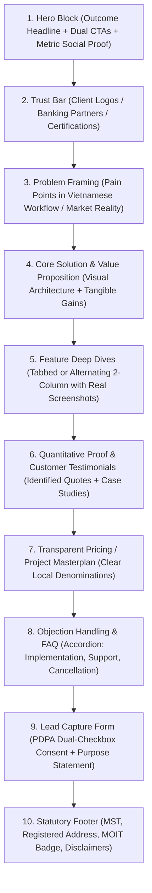

<!-- vlc-disable: all -->

# Register Guide & Conversion Architecture (`vietnamese-landing-copy`)

In Vietnamese marketing copywriting, tone of voice is not a cosmetic layer applied to an English sentence. Vietnamese encodes social distance, prestige, institutional authority, and emotional resonance directly into lexicon selection, classifier choice, and syntactic rhythm.

---

## 1. The Hán-Việt vs. Thuần Việt Prestige Axis

Vietnamese vocabulary sits on a dual-register continuum:
- **Thuần Việt (Native Vietnamese):** Concrete, sensory, physical, immediate, personal. Best for high-velocity conversion, SaaS product mechanics, onboarding instructions, and modern consumer tech.
- **Hán-Việt (Sino-Vietnamese):** Conceptual, institutional, prestige-signalling, formal, abstract. Best for real estate, wealth management, luxury retail, legal terms, and institutional governance.

### Lexical Distribution by Vertical

| Vertical | Hán-Việt : Thuần Việt Ratio | Lexicon Examples | Pragmatic Purpose |
|---|---|---|---|
| **Real Estate & Hospitality** | 70% : 30% | *kiến tạo, an cư, đắc địa, thịnh vượng, tuyệt tác, cảnh quan* | Signals generational wealth, architectural permanence, high social status |
| **Private Banking & Wealth** | 65% : 35% | *tài sản, tích lũy, đặc quyền, bảo toàn, gia tăng, minh bạch* | Builds institutional trust, fiduciary prudence, prestige |
| **Enterprise B2B & Cloud** | 50% : 50% | *chuyển đổi số, tự động hóa, tối ưu quy trình, hiệu năng, bảo mật* | Balances technical precision with corporate executive seriousness |
| **FinTech & E-Wallets** | 40% : 60% | *thanh toán một chạm, liên kết ngân hàng, nhận tiền tức thì, quét mã* | Demystifies finance; emphasizes speed, convenience, daily utility |
| **SaaS & AI Platforms** | 30% : 70% | *giao việc, theo dõi, nhắc việc, dùng thử, kết nối, làm việc nhóm* | Low cognitive load; prioritizes immediate utility and speed |
| **E-Commerce & D2C** | 20% : 80% | *săn sale, deal sốc, giao nhanh, hàng xịn, xem ngay, đổi trả* | Creates retail momentum, emotional excitement, frictionless checkout |

### Lexical Pairs Across the Prestige Axis

| English Meaning | Thuần Việt (SaaS / E-Com / Everyday) | Hán-Việt (Real Estate / Luxury / Banking) |
|---|---|---|
| Build / Create | `xây dựng`, `tạo ra`, `làm nên` | `kiến tạo`, `khởi sinh`, `thiết lập` |
| Place to live | `nhà ở`, `chỗ ở`, `nơi ở` | `chốn an cư`, `tổ ấm thịnh vượng`, `không gian sống` |
| Beautiful view | `nhìn đẹp`, `nhìn ra sông` | `tầm nhìn đắt giá`, `hướng nhìn triệu đô`, `ôm trọn cảnh quan` |
| Good location | `chỗ tiện đi lại`, `ở trung tâm` | `tọa độ kim cương`, `vị trí đắc địa`, `kết nối huyết mạch` |
| Safety / Security | `giữ kín`, `an toàn`, `không lộ` | `bảo mật tuyệt đối`, `an ninh đa lớp`, `riêng tư biệt lập` |
| Privilege | `ưu đãi riêng`, `cho người đặc biệt` | `đặc quyền thượng lưu`, `đặc quyền giới hạn` |

---

## 2. Classifier Discipline (`Loại từ`)

Vietnamese nouns for concrete physical and digital assets cannot stand alone with numbers or demonstratives without their natural grammatical classifiers (*loại từ*). Translating English without classifiers produces robotic, broken phrasing.

### The Real Estate & Hospitality Classifiers

- **`căn`:** Used for finished residential units (`căn hộ`, `căn biệt thự`, `căn penthouse`, `căn shophouse`, `căn nhà phố`).
  - *Correct:* *"Sở hữu căn hộ 2 phòng ngủ chỉ từ 3,2 tỷ đồng."*
  - *Defective:* *"Sở hữu hộ 2 phòng ngủ..."*
- **`toà` (or `tòa`):** Used for large residential or commercial towers (`toà tháp`, `toà nhà văn phòng`, `toà phức hợp`).
  - *Correct:* *"Phân khu gồm 3 toà tháp vươn mình bên bờ sông."*
- **`nền`:** Used for subdivided plots of residential land (`nền đất`, `đất nền`).
  - *Correct:* *"Mở bán 50 nền đất có sổ đỏ từng nền."*
- **`lô`:** Used for industrial plots, commercial blocks, or wholesale land allocations (`lô đất`, `lô shophouse`).
  - *Correct:* *"Quy hoạch gồm 12 lô thương mại dịch vụ."*
- **`dự án`:** Used for developments as an institutional whole (`dự án khu đô thị`, `dự án căn hộ nghỉ dưỡng`).

### The Digital & Product Classifiers

- **`gói`:** For service tiers, pricing plans, and insurance policies (`gói dịch vụ`, `gói Starter`, `gói Enterprise`).
- **`bản`:** For software releases, contracts, and reports (`bản cập nhật`, `bản demo`, `bản báo cáo`).
- **`tính năng`:** For functional capabilities (`tính năng xuất báo cáo`, `tính năng tự động hóa`).
- **`khoản`:** For financial sums and payments (`khoản thanh toán`, `khoản vay`, `khoản tiền gửi`).

---

## 3. Persuade-Mode Section Rhythm & Scroll Architecture

A high-converting Vietnamese landing page follows an intentional psychological progression designed to address local buying skepticism, establish institutional credibility, and drive frictionless action.

### Breakdown of Section Craft

### Section 1: The Hero Section
- **Eyebrow Badge:** Highlighting urgency, novelty, or official status (*"Chính thức ra mắt phiên bản 2.0"* / *"Giai đoạn mở bán đợt 1"*).
- **H1 Headline:** Direct, benefit-first, active voice. Maximum 12–14 words.
- **Sub-headline:** Explaining how the benefit is achieved while overcoming the primary objection (*"không cần thẻ tín dụng"*, *"bàn giao sổ hồng riêng"*).
- **CTA Cluster:** High-contrast primary action (*"Dùng thử miễn phí 14 ngày"* / *"Đăng ký nhận báo giá"*) paired with low-commitment secondary action (*"Đặt lịch demo"* / *"Tải mặt bằng dự án"*).

### Section 2: Social Proof & Trust Anchors
Vietnamese buyers exhibit high risk-aversion. Place social proof immediately below the Hero fold:
- Enterprise logos (`Được hơn 500 tập đoàn tin cậy`).
- Regulatory licenses (Chứng nhận bảo mật PCI DSS, Giấy phép Ngân hàng Nhà nước, Giấy phép xây dựng).

### Section 3 & 4: Problem to Solution Architecture
- Avoid abstract philosophical prose. Contrast the painful status quo (*"Mất 4 giờ mỗi ngày để đối soát bảng tính thủ công"*) with the automated Vietnamese reality (*"Tự động đồng bộ ngân hàng và xuất hóa đơn điện tử trong 30 giây"*).

### Section 5: Feature Deep Dives
- Use active Vietnamese verb phrases for section subheads: *"Tự động hóa đối soát"*, *"Quản lý dòng tiền đa tài khoản"*, *"Phân quyền bảo mật theo phòng ban"*.
- Never translate English passive features into Vietnamese passive sentences.

### Section 6: Verified Social Proof
- Customer quotes must include real name, title, and organization. Generic *"Khách hàng giấu tên"* triggers immediate scam alerts in Vietnam.

### Section 7: Pricing & Real Estate Investment Table
- Clearly separate net price from VAT and statutory maintenance fees.
- Never mix full grouped numbers (`500.000 ₫`) with word scales (`500k` or `500 nghìn`) within the same comparison table.

### Section 8: Objection-Handling FAQ
- Frame questions using natural Vietnamese customer phrasing (*"Tôi có được hoàn tiền không?"*, *"Dữ liệu của doanh nghiệp có được lưu trữ tại Việt Nam không?"*).

### Section 9 & 10: Lead Form & Statutory Disclosures
- Compliant with Luật 91/2025/QH15 Điều 9 and Nghị định 356/2025/NĐ-CP Điều 6 (explicit consent checkbox + purpose, unchecked by default).
- Full legal footer satisfying Bộ Công Thương (MST, company name, address, hotline).

---

## 4. Self-Reference and Reader Address Discipline

- **Self-Reference:** A business or landing page speaks as `chúng tôi` (exclusive "we"), never `chúng ta` (inclusive "we"), because the visitor is not an employee or co-founder of your company.
- **Direct Address:**
  - `saas`: Use `bạn` across headings, instructions, and error states.
  - `re`: Use `Quý khách` across consultation forms, project overviews, and concierge services.
  - `b2b`: Use `Quý doanh nghiệp` or `anh/chị` for personal enterprise consultations.
  - `ux-microcopy`: Omit pronouns on action buttons and input labels entirely.
