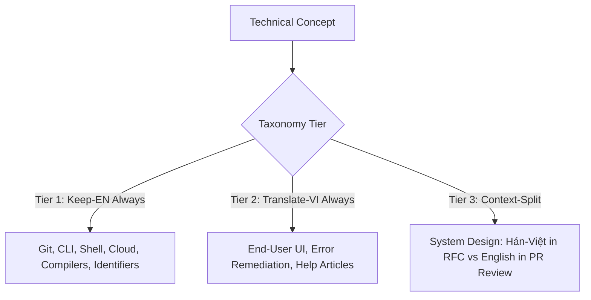

<!-- vlc-disable: all -->

# Code-Switching Taxonomy — Technical & Engineering Lexicon (`vietnamese-tech-writing`)

Vietnamese software engineering communication is inherently bilingual. Native Vietnamese developers do not translate every term into Vietnamese; doing so produces pedantic, confusing text that hinders comprehension. At the same time, leaving every common noun in English produces sloppy "Jargon-Slop" that alienated product managers and end-users.

This reference provides a taxonomy across 100+ engineering, cloud, AI/ML, and product management concepts.

---

## 1. The Three Tiers of Technical Code-Switching

1. **Tier 1 — Keep-EN Always (100% English):**
   Tool commands, environment names, protocol abbreviations, code tokens, and core Git operations. Translating these is a defect in any document.
2. **Tier 2 — Translate-VI Always (100% Vietnamese):**
   User-facing states, error instructions, input validations, general computing nouns. Leaving these in English creates foreign UI friction.
3. **Tier 3 — Context-Split (Split by Document Formality):**
   Terms that take formal Sino-Vietnamese in published architecture specs (RFCs, ADRs, textbooks) but remain English in team PR comments, Slack discussions, and developer blogs.

---

## 2. Comprehensive Lexicon: 100+ Core Terms

### Category A: Git & Version Control
| English Term | Tier | PR Review / Slack | Published Spec / RFC | Notes |
|---|:---:|---|---|---|
| `commit` | Tier 1 | `commit` | `commit` | Never `cam kết` (means to pledge) |
| `push` / `pull` | Tier 1 | `push` / `pull` | `push` / `pull` | Shell commands stay English |
| `branch` | Tier 3 | `branch` / `nhánh` | `nhánh phát triển` | Both acceptable |
| `merge` | Tier 1 | `merge` | `merge` | Never `hợp nhất chi nhánh` |
| `rebase` | Tier 1 | `rebase` | `rebase` | Git algorithmic operation |
| `cherry-pick` | Tier 1 | `cherry-pick` | `cherry-pick` | Git command |
| `pull request` (PR) | Tier 1 | `PR` / `pull request` | `yêu cầu xét duyệt mã nguồn (PR)` | Standard developer term |
| `stash` | Tier 1 | `stash` | `lưu tạm (stash)` | Standard developer term |
| `conflict` | Tier 3 | `conflict` | `xung đột mã nguồn` | Both used natively |
| `tag` / `release` | Tier 3 | `tag` / `release` | `phiên bản phát hành` | Both acceptable |

### Category B: Runtime Environments & Infrastructure
| English Term | Tier | PR Review / Slack | Published Spec / RFC | Notes |
|---|:---:|---|---|---|
| `production` | Tier 1 | `production` / `prod` | `môi trường production` | Never `sản xuất` |
| `staging` | Tier 1 | `staging` | `môi trường staging` | Never `dàn dựng` |
| `development` (dev)| Tier 1 | `dev` / `local` | `môi trường phát triển` | Never `sự phát triển` |
| `server` | Tier 3 | `server` | `máy chủ` | `máy chủ` in formal documentation |
| `client` | Tier 3 | `client` | `phía máy khách (client)` | Context dependent |
| `cluster` | Tier 1 | `cluster` | `cụm máy chủ (cluster)` | Keep English abbreviation |
| `node` | Tier 1 | `node` | `nút xử lý (node)` | Infrastructure node |
| `pod` | Tier 1 | `pod` | `pod Kubernetes` | Never translate pod |
| `container` | Tier 3 | `container` | `vùng chứa (container)` | Containerization technology |
| `load balancer` | Tier 3 | `load balancer` | `bộ cân bằng tải` | `bộ cân bằng tải` is standard |
| `proxy` / `reverse proxy`| Tier 3 | `proxy` | `máy chủ ủy quyền ngược` | Usually proxy in engineering |
| `firewall` | Tier 3 | `firewall` | `tường lửa` | Both forms widely recognized |
| `pipeline` (CI/CD) | Tier 1 | `pipeline` | `luồng tự động hóa (pipeline)` | CI/CD concept |
| `worker` | Tier 1 | `worker` | `tiến trình nền (worker)` | Asynchronous worker process |

### Category C: Software Architecture & Data Systems
| English Term | Tier | PR Review / Slack | Published Spec / RFC | Notes |
|---|:---:|---|---|---|
| `cache` | Tier 3 | `cache` | `bộ nhớ đệm` | `bộ nhớ đệm` in formal RFCs |
| `database` | Tier 3 | `DB` / `database` | `cơ sở dữ liệu` | `cơ sở dữ liệu` universal in formal docs |
| `table` | Tier 2 | `table` / `bảng` | `bảng dữ liệu` | Translate in product/UI |
| `column` / `row` | Tier 2 | `cột` / `dòng` | `cột` / `hàng` | Translate in product/UI |
| `index` | Tier 3 | `index` | `chỉ mục` | Database indexing |
| `query` | Tier 3 | `query` | `truy vấn dữ liệu` | Both forms live |
| `schema` | Tier 3 | `schema` | `lược đồ dữ liệu` | Both forms live |
| `message queue` | Tier 3 | `message queue` | `hàng đợi thông điệp` | Engineers lean English |
| `event-driven` | Tier 3 | `event-driven` | `hướng sự kiện` | Architectural paradigm |
| `microservices` | Tier 1 | `microservices` | `kiến trúc microservices` | Architectural pattern |
| `monolith` | Tier 1 | `monolith` | `kiến trúc nguyên khối (monolith)` | Architectural pattern |
| `API endpoint` | Tier 1 | `endpoint` | `điểm cuối API` | Keep ASCII identifiers |
| `payload` | Tier 3 | `payload` | `dữ liệu tải (payload)` | Request/Response payload |
| `middleware` | Tier 3 | `middleware` | `lớp phần mềm trung gian` | Architectural component |

### Category D: AI/ML & LLM Engineering
| English Term | Tier | PR Review / Slack | Published Spec / RFC | Notes |
|---|:---:|---|---|---|
| `prompt` | Tier 1 | `prompt` | `câu lệnh gợi ý (prompt)` | Keep prompt in AI docs |
| `fine-tuning` | Tier 1 | `fine-tune` | `tinh chỉnh mô hình (fine-tuning)` | Standard ML term |
| `embedding` | Tier 3 | `embedding` | `véc-tơ nhúng (embedding)` | Vector representation |
| `token` | Tier 1 | `token` | `token ngôn ngữ` | LLM unit |
| `context window` | Tier 3 | `context window` | `cửa sổ ngữ cảnh` | Both widely understood |
| `hallucination` | Tier 3 | `hallucination` | `hiện tượng ảo giác (hallucination)` | LLM ungrounded output |
| `grounding` | Tier 3 | `grounding` | `đối chiếu dữ liệu thực tế` | RAG concept |
| `latency` | Tier 3 | `latency` | `độ trễ phản hồi` | Performance metric |
| `throughput` | Tier 3 | `throughput` | `lưu lượng xử lý` | Performance metric |

### Category E: Product Management & Agile Workflows
| English Term | Tier | PR Review / Slack | Published Spec / RFC | Notes |
|---|:---:|---|---|---|
| `sprint` | Tier 1 | `sprint` | `chu kỳ sprint` | Never `chạy nước rút` |
| `backlog` | Tier 1 | `backlog` | `danh mục công việc (backlog)` | Never `tồn đọng` |
| `standup` | Tier 1 | `standup` | `buổi họp standup hàng ngày` | Never `họp đứng dậy` |
| `retro` | Tier 1 | `retro` | `buổi họp cải tiến (retrospective)` | Agile ceremony |
| `roadmap` | Tier 3 | `roadmap` | `lộ trình phát triển sản phẩm` | Both widely used |
| `user story` | Tier 2 | `user story` | `câu chuyện người dùng` | Formula: `Là [X], tôi muốn [Y]` |
| `acceptance criteria`| Tier 2 | `acceptance criteria` | `tiêu chí nghiệm thu` | Formal product spec |
| `feature` | Tier 2 | `feature` / `tính năng` | `tính năng sản phẩm` | User-facing capability |
| `onboarding` | Tier 3 | `onboarding` | `quy trình làm quen sản phẩm` | Never `lên tàu` |
| `conversion rate` | Tier 2 | `tỷ lệ chuyển đổi` | `tỷ lệ chuyển đổi (CR)` | Standard analytics |
| `churn rate` | Tier 2 | `tỷ lệ rời bỏ` | `tỷ lệ khách hàng rời bỏ (churn rate)`| Standard analytics |

---

## 3. The Grammar of Mixed Engineering Sentences

When code-switching inside Vietnamese sentences, observe three syntactic rules:

1. **Vietnamese Function Words, English Technical Words:**
   Use native Vietnamese prepositions (`lên`, `vào`, `ở`, `qua`), modal verbs (`cần`, `phải`, `sẽ`), and conjunctions (`sau khi`, `đồng thời`), while keeping technical terms English:
   - *Natural:* *"Sau khi review xong PR, mình sẽ merge vào nhánh main rồi deploy lên staging."*
   - *Robotic Calque:* *"Sau khi ôn tập xong yêu cầu kéo, mình sẽ hợp nhất vào chi nhánh chính rồi triển khai đến dàn dựng."*

2. **English Verb Direct Objects:**
   When an English technical verb is used transitively in Vietnamese, it functions as a loan verb without needing particle glue:
   - Write: *"Hệ thống sẽ retry request 3 lần trước khi bắn alert."*
   - Never write: *"Hệ thống sẽ thực hiện thử lại yêu cầu 3 lần trước khi làm một cảnh báo."*

3. **Identifier Integrity:**
   All function names, database keys, environment variables, and CLI parameters remain strictly ASCII: `processPayment()`, `user_id`, `MAX_RETRIES`, `--output-format=json`.
